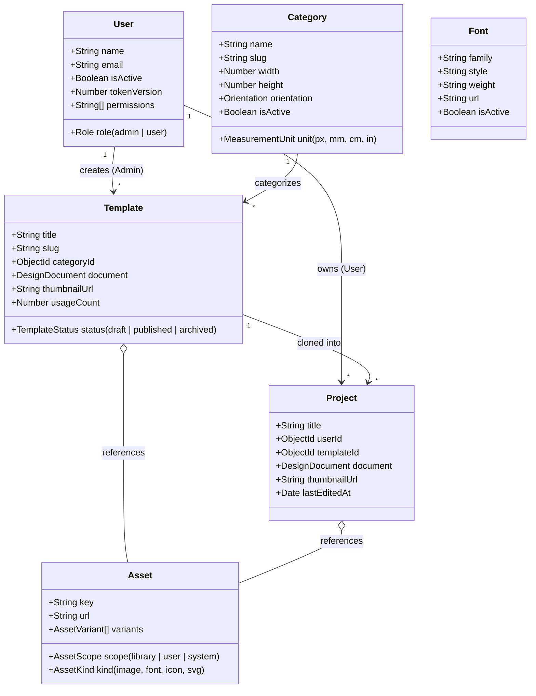
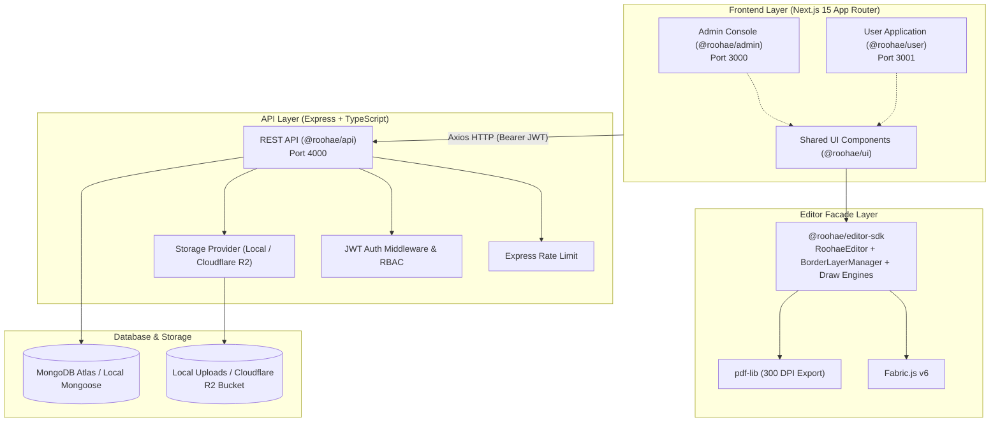
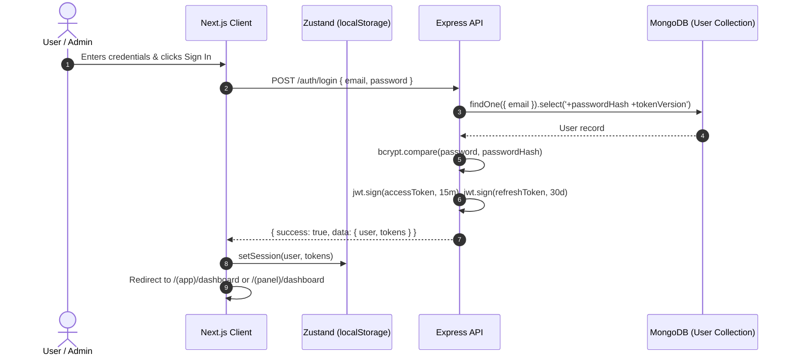

# Roohae — Codebase Documentation & Architecture Guide

A template-driven, Canva-class design and publishing SaaS platform. Admins author, structure, and publish multi-page design templates with strict lock/editable controls. Users browse published designs, customize designated editable fields (text, shapes, permitted replacement images), draw, add signatures, and generate print-ready vector/raster exports (PNG, JPG, 300 DPI PDF).

---

## 1. Project Overview

### What Roohae Is
**Roohae** is a multi-tenant, template-driven design and publishing platform designed to guarantee strict visual brand integrity while giving end-users rich, frictionless personalization capabilities.

### Main Purpose
Traditional design tools allow users to alter arbitrary elements, leading to broken layouts, misaligned logos, and inconsistent branding. Roohae solves this by separating **Template Authorship (Admin)** from **Template Customization (User)**:
- **Admins** have unrestricted creative freedom: creating categories with fixed physical dimensions, defining page layouts, adding graphics, vectors, borders, text, and marking specifically which elements are `editable` or `locked`.
- **Users** cannot create blank designs or modify locked corporate branding. Users open a published template, which creates an isolated personal project copy (`Project`), modify allowed fields, upload replacement images within admin constraints, and download high-resolution exports.

### Core Domain Entities & Relationships



- **Users**: Identified by JWT session with RBAC (`admin` vs `user`). Non-admin users are strictly blocked from admin panel endpoints and template mutation APIs.
- **Companies / Organizations**: Scoped multi-tenant support prepared in user permissions and asset scoping (`library` vs `user` assets).
- **Admin**: Authors templates, manages categories, uploads global library assets, activates custom web fonts, and monitors system analytics and activity logs.
- **Sub-admin**: Admin accounts with fine-grained permissions array for administrative operational tasks.
- **Templates**: Central catalog of master designs created by admins. Must be in `published` status for users to browse and instantiate.
- **Design Editor**: Fabric.js-powered visual workspace isolated through `@roohae/editor-sdk`. Supports text, images, shapes, procedural borders, drawing tools, sticky notes, WordArt, QR codes, and digital signatures.
- **Projects**: User-owned instances cloned from published templates. Every project mutation is validated server-side to guarantee locked elements were not tampered with.
- **Orders / Exports**: Native export engine producing lossless PNGs, compressed JPGs, and multi-page print-ready 300 DPI PDFs.

---

## 2. Current Project Architecture

### High-Level Architecture Diagram



### Architectural Pillars

1. **Monorepo Workspace Structure**: Managed via npm workspaces (`packages/*`, `apps/*`). Common schemas, types, and validation rules live in `@roohae/shared` to enforce end-to-end type safety between backend and frontend.
2. **Editor Facade Isolation**: React UI components *never* manipulate Fabric.js canvas objects directly. They interact strictly with the `RoohaeEditor` facade class in `@roohae/editor-sdk`. This allows swapping the underlying canvas engine in the future without touching the UI layer.
3. **Editable-Field Locking Verification**: When saving a user project, `projectsService` re-validates the submitted JSON against the original master template:
   - Ensures no objects were added or removed (`assertObjectSetUnchanged`).
   - Ensures locked/non-editable objects are byte-identical to the master template (`assertLockedObjectsUnchanged`).
   - Verifies replacement assets conform to template placeholder constraints (`assertPlaceholderRulesRespected`).
   - Verifies user ownership of uploaded assets (`assertForeignAssetsOwned`).
4. **Content-Addressed Asset Management**: Assets are uploaded to local storage or Cloudflare R2 with content-addressed keys. Derived WebP thumbnails are generated via `sharp` for fast UI loading while preserving pristine original binaries for 300 DPI print exports.
5. **Session & Security Model**: JWT access tokens (15-minute TTL) with HTTP refresh token rotation and database-backed `tokenVersion` revocation.

---

## 3. Folder Structure

```
roohae_cards/
├── apps/
│   ├── admin/             # Next.js 15 Admin Console (port 3000)
│   ├── api/               # Express + TypeScript + Mongoose REST API (port 4000)
│   └── user/              # Next.js 15 User Design Platform (port 3001)
├── packages/
│   ├── editor-sdk/        # Fabric.js abstraction, drawing engines, border manager, exports
│   ├── shared/            # Single source of truth: Zod schemas, TypeScript types, constants
│   └── ui/                # Shared design system, EditorWorkspace, panels, controls
├── scratch/               # Local developer utilities and standalone test harnesses
├── package.json           # Monorepo root npm workspaces definition
└── tsconfig.base.json     # Base TypeScript compiler configuration
```

### Folder Responsibilities & Dependencies

#### `packages/shared/`
- **Purpose**: Defines shared domain entities, Zod validation schemas, measurement constants, and TypeScript interfaces.
- **Key Modules**:
  - `schemas/`: Zod schemas for auth, templates, projects, categories, assets, and design documents.
  - `types/`: Domain interfaces (`DesignDocument`, `DesignObject`, `User`, `Template`, `Project`).
  - `constants.ts`: System constants (dimensions, units, export formats, autosave intervals).
- **Dependencies**: Zero external internal dependencies. Consumed by `api`, `admin`, `user`, `ui`, and `editor-sdk`.

#### `packages/editor-sdk/`
- **Purpose**: Fully encapsulates Fabric.js canvas interactions, custom procedural rendering, export rendering, and history.
- **Key Modules**:
  - `RoohaeEditor.ts`: Master facade exposing high-level operations (`addText`, `removeBackgroundFromSelected`, `undo`, `redo`, `serialize`).
  - `BorderLayerManager.ts`: Page border geometry calculator and procedural renderer for solid, dashed, and dotted strokes.
  - `ExportService.ts`: Offscreen static canvas renderer for PNG, JPG, and 300 DPI PDF generation.
  - `HistoryManager.ts`: State snapshot stack managing Undo/Redo commands.
  - `tools/draw/`: Procedural brush engines (Pencil, Pen, Marker, Highlighter, Brush, Chalk, Spray, Eraser).
  - `tools/`: Specialized modules for Sticky Notes, WordArt, QR Code, Signatures, and Shapes.
- **Dependencies**: Depends on `fabric`, `pdf-lib`, and `@roohae/shared`.

#### `packages/ui/`
- **Purpose**: Shared visual design system, complex editor panels, controls, and API client.
- **Key Modules**:
  - `editor/EditorWorkspace.tsx`: Top-level flex layout integrating TopBar, LeftSidebar, Canvas workspace, and PropertiesPanel.
  - `editor/PropertiesPanel.tsx`: Context-sensitive sidebar adapting to selected element types (Text, Image, Shape, Draw, Border).
  - `editor/ToolsPanel.tsx`: Accordion/card tool selector for borders, drawing brushes, sticky notes, WordArt, and signatures.
  - `editor/TopBar.tsx`: Document title, back button, undo/redo, autosave status indicator, preview, and export triggers.
  - `lib/api.ts`: Axios client factory with bearer token interceptor and automatic token refresh.
  - `lib/auth-store.ts`: Zustand store with localStorage persistence for user sessions.
- **Dependencies**: Depends on `@roohae/editor-sdk`, `@roohae/shared`, `@radix-ui/*`, `lucide-react`, `zustand`, `sonner`.

#### `apps/api/`
- **Purpose**: Express.js REST API providing business logic, authentication, data persistence, and asset storage.
- **Key Modules**:
  - `modules/auth/`: Registration, login, token refresh, password changes, profile management.
  - `modules/templates/`: Template CRUD, lifecycle status (`draft`/`published`), asset resolution, cloning.
  - `modules/projects/`: User project persistence, deep copy creation, tamper-prevention validation.
  - `modules/categories/`: Dimension templates and category classifications.
  - `modules/assets/`: Multi-part asset uploads, image metadata extraction via `sharp`, variant generation.
  - `modules/fonts/`: Custom typography catalog and WOFF/TTF font registration.
  - `modules/dashboard/` & `modules/activity/`: System statistics and audit logging.
- **Dependencies**: Depends on `mongoose`, `jsonwebtoken`, `bcryptjs`, `multer`, `sharp`, `@aws-sdk/client-s3`, `@roohae/shared`.

#### `apps/admin/`
- **Purpose**: Back-office administration portal for managing the platform, uploading library assets, creating templates, and monitoring users.
- **Key Routes**:
  - `/login`: Admin authentication portal (rejects non-admin roles).
  - `/(panel)/dashboard`: High-level metrics (users, templates, projects, activity).
  - `/(panel)/categories`: Category management with physical card dimensions and units.
  - `/(panel)/templates`: Template list with status filters (`draft`, `published`, `archived`).
  - `/editor/[templateId]`: Full-screen template authoring studio.
  - `/(panel)/uploads`: Global asset library manager.
  - `/(panel)/fonts`: Custom font uploader and activator.
  - `/(panel)/users`: User account list and activation switch.

#### `apps/user/`
- **Purpose**: Public-facing customer platform for discovering templates, customizing designs, and generating print exports.
- **Key Routes**:
  - `/`: Landing page and template showcase.
  - `/login` & `/register`: Customer authentication.
  - `/(app)/dashboard` & `/(app)/projects`: Customer dashboard and "My Designs" list.
  - `/design/[templateId]`: Draft preview and initial customization session.
  - `/editor/[projectId]`: Saved project customization studio with autosave.

---

## 4. Editor Architecture

The editor is built around an offscreen and on-screen dual-canvas architecture governed by `@roohae/editor-sdk`.

```
                    ┌─────────────────────────┐
                    │   React UI Workspace    │
                    │   (EditorWorkspace)     │
                    └────────────┬────────────┘
                                 │ Facade calls
                    ┌────────────▼────────────┐
                    │      RoohaeEditor       │
                    │  (packages/editor-sdk)  │
                    └──────┬───────────┬──────┘
                           │           │
            ┌──────────────▼─────┐   ┌─▼──────────────────┐
            │  Fabric.js Canvas  │   │   ExportService    │
            │   (Interactive)    │   │ (Offscreen Canvas) │
            └────────────────────┘   └────────────────────┘
```

- **Canvas & Coordinate Space**: Document dimensions (`width` × `height`) represent the true physical design boundary. Canvas viewport scaling calculates a zoom ratio based on container bounding client rect, centering the design with drop-shadow margins.
- **Objects**: Every object on the canvas implements custom metadata (`Rooh` interface):
  - `id`: Unique UUID generated via `newObjectId()`.
  - `name`: Display name shown in the Layers panel.
  - `roohEditable`: Boolean flag toggled by admins to determine user mutability.
  - `locked`: Disables movement, rotation, and scaling.
  - `roohAssetType`: Categorizes vectors (`border`, `line`, `draw`, `signature`, `text`, `image`).
- **Selection**: Selection events dispatch to the `emitter`. `PropertiesPanel` subscribes to selection updates, dynamically displaying typography controls, color pickers, border settings, or background matting tools.
- **Layers**: Objects maintain Z-index order inside Fabric's canvas stack. `RoohaeEditor` provides `bringForward`, `sendBackward`, `bringToFront`, and `sendToBack` methods.
- **Text & Typography**: Supports standard textboxes with real-time tracking of font family, font size, fill color, line height, letter spacing, text alignment, and styles (bold, italic, underline, uppercase).
- **Images**: Rendered with preserved aspect ratio. In user mode, replacement images can be picked from an admin-allowed gallery or uploaded directly if permitted.
- **Background Remover**: Built into `RoohaeEditor.removeBackgroundFromSelected(tolerance)`. Renders the image to an offscreen canvas at native resolution, samples perimeter border pixels to identify the background chroma, applies alpha threshold matting with soft-edge interpolation, and replaces the layer in-place without coordinate drift.
- **History (Undo / Redo)**: Managed by `HistoryManager`. State snapshots of the document pages are pushed to an undo stack upon user mutations, with debounce handling for continuous sliders.
- **Exporting**: Managed by `ExportService`. Recreates the document page-by-page on an offscreen `StaticCanvas` at full native scale or high-DPI multiplier, outputting lossless PNG, compressed JPEG, or multi-page 300 DPI PDF files via `pdf-lib`.

---

## 5. Border Engine

The Border Engine is located in `packages/editor-sdk/src/BorderLayerManager.ts`. It provides procedural borders that fit the document perimeter without clipping or distorted corner scaling.

### Implementation Details
- **Class**: `PageBorder extends FabricObject` (registered in Fabric's `classRegistry`).
- **Native Bounds Safety Net**: Traditional Fabric strokes expand the bounding box, distorting selection handles and shifting object origins. `PageBorder` forces `strokeWidth = 0` internally and stores the stroke size in `roohBorderThickness`.
- **Dimensions & Padding**: The border geometry is mathematically calculated as:
  $$\text{Width} = \text{docWidth} - (\text{padding} \times 2)$$
  $$\text{Height} = \text{docHeight} - (\text{padding} \times 2)$$
  The layer is anchored at `(docWidth / 2, docHeight / 2)` with `originX: 'center'` and `originY: 'center'` to guarantee symmetric growth.
- **Stroke Styles**:
  - **Solid**: Uses `ctx.rect(-w/2, -h/2, w, h)` with `ctx.lineWidth = thickness`.
  - **Dashed**: Calculates equal-spaced dash points ($D = 18\text{px}$) across width and height ($K_w, K_h$). Distributes remaining space perfectly ($G_w, G_h$) and renders solid square corner miters at all four outer vertices.
  - **Dotted**: Computes circular dot points spaced by target distance ($14\text{px}$) and renders filled arcs along all four borders without corner overlap.
- **UI Controls**:
  - Activated from `ToolsPanel.tsx` under "Borders & Lines".
  - Configured from `PropertiesPanel.tsx` via padding and thickness sliders and color fields.
  - Functions: `BorderLayerManager.createBorderLayer()`, `updateBorderPadding()`, `updateBorderThickness()`, `updateBorderColor()`, `updateBorderStyle()`.

---

## 6. Draw Engine

Located in `packages/editor-sdk/src/tools/draw/`, the Draw Engine implements Canva-style freehand drawing and vector erasing.

### Architecture
- **`BaseDrawTool`**: Base class handling canvas event interception. When draw mode activates, existing canvas objects have `selectable` and `evented` disabled, setting the crosshair cursor so clicks draw strokes rather than selecting existing layers.
- **`BaseDrawEngine`**: Subclasses `BaseDrawTool`. Manages pointer coordinates, point buffering, velocity/pressure approximation, and path smoothing via `smoothPathFromPoints` (Catmull-Rom spline interpolation).
- **History Integration**: Completing a stroke converts points into a finalized `Fabric.Path` with custom `roohAssetType: 'draw'` and records an undo snapshot.

### Brushes

| Brush | Engine File | Characteristics |
| :--- | :--- | :--- |
| **Pencil** | `PencilEngine.ts` | Thin, uniform line width, fixed opacity. |
| **Pen** | `DrawPenEngine.ts` | Crisp, velocity-sensitive ink stroke with smooth tapered caps. |
| **Marker** | `MarkerEngine.ts` | Semi-transparent felt-tip with square cap simulation. |
| **Highlighter** | `HighlighterEngine.ts` | Broad width, translucent blend (`multiply` or 40% opacity), rounded caps. |
| **Brush** | `BrushEngine.ts` | Artistic bristle texture with multi-layered stroke simulation. |
| **Chalk** | `ChalkEngine.ts` | Textured grainy particles with randomized noise along the stroke path. |
| **Spray** | `SprayEngine.ts` | Radial particle distribution with density and flow controls. |
| **Eraser** | `EraserEngine.ts` | Circular cursor that performs geometric intersection tests on draw paths, splitting or removing intersected vectors. |

---

## 7. API Documentation

All endpoints return a standardized envelope:
```typescript
type ApiResponse<T> = 
  | { success: true; data: T; meta?: { page: number; limit: number; total: number } }
  | { success: false; error: { code: string; message: string; details?: unknown } };
```

### 1. Authentication (`/auth`)

| Method | Endpoint | Purpose | Roles | Handler | Database Ops |
| :--- | :--- | :--- | :--- | :--- | :--- |
| `POST` | `/auth/register` | Register new customer account | Public | `auth.controller.register` | `User.create` |
| `POST` | `/auth/login` | Authenticate customer or admin | Public | `auth.controller.login` | `User.findOne`, verify bcrypt |
| `POST` | `/auth/refresh` | Refresh expired access token | Public | `auth.controller.refresh` | `User.findById`, verify `tokenVersion` |
| `GET` | `/auth/me` | Fetch active profile | Authenticated | `auth.controller.me` | `User.findById` |
| `PATCH`| `/auth/profile` | Update user name/avatar | Authenticated | `auth.controller.updateProfile` | `User.findByIdAndUpdate` |
| `POST` | `/auth/change-password` | Update account password | Authenticated | `auth.controller.changePassword` | `User.updateOne`, bump `tokenVersion` |

### 2. Categories (`/categories`)

| Method | Endpoint | Purpose | Roles | Handler | Database Ops |
| :--- | :--- | :--- | :--- | :--- | :--- |
| `GET` | `/categories` | List active categories | Authenticated | `categories.controller.list` | `Category.find` |
| `GET` | `/categories/:id` | Get category details | Authenticated | `categories.controller.getById` | `Category.findById` |
| `POST` | `/categories` | Create card category | Admin only | `categories.controller.create` | `Category.create` |
| `PATCH`| `/categories/:id` | Update category dimensions | Admin only | `categories.controller.update` | `Category.findByIdAndUpdate` |
| `DELETE`| `/categories/:id` | Delete category | Admin only | `categories.controller.remove` | `Category.deleteOne` |

### 3. Templates (`/templates`)

| Method | Endpoint | Purpose | Roles | Handler | Database Ops |
| :--- | :--- | :--- | :--- | :--- | :--- |
| `GET` | `/templates` | Paginate templates (users only see published) | Authenticated | `templates.routes.get` | `Template.find` |
| `GET` | `/templates/:id`| Fetch master template document | Authenticated | `templates.routes.getById` | `Template.findById` |
| `POST` | `/templates` | Create blank template | Admin only | `templates.routes.post` | `Template.create` |
| `PATCH`| `/templates/:id`| Update title, document JSON, thumbnail | Admin only | `templates.routes.patch` | `Template.findByIdAndUpdate` |
| `PATCH`| `/templates/:id/status` | Publish / Unpublish template | Admin only | `templates.routes.patchStatus`| `Template.updateOne` |
| `POST` | `/templates/:id/duplicate` | Clone template to new draft | Admin only | `templates.routes.duplicate` | `Template.create` |
| `DELETE`| `/templates/:id`| Remove template | Admin only | `templates.routes.delete` | `Template.deleteOne` |

### 4. Projects (`/projects`)

| Method | Endpoint | Purpose | Roles | Handler | Database Ops |
| :--- | :--- | :--- | :--- | :--- | :--- |
| `GET` | `/projects` | Paginate user's saved projects | Authenticated | `projects.routes.get` | `Project.find({ userId })` |
| `GET` | `/projects/:id` | Get user project document | Owner only | `projects.routes.getById` | `Project.findOne({ _id, userId })` |
| `POST` | `/projects` | Clone published template into project | Authenticated | `projects.routes.post` | Validate + `Project.create` |
| `PATCH`| `/projects/:id` | Autosave customized project document | Owner only | `projects.routes.patch` | Validate locks + `Project.updateOne` |
| `DELETE`| `/projects/:id` | Delete user project | Owner only | `projects.routes.delete` | `Project.deleteOne({ _id, userId })` |

### 5. Assets (`/assets`)

| Method | Endpoint | Purpose | Roles | Handler | Database Ops |
| :--- | :--- | :--- | :--- | :--- | :--- |
| `GET` | `/assets` | Paginate library assets | Authenticated | `assets.controller.paginate` | `Asset.find` |
| `POST` | `/assets` | Upload raster images / icons | Authenticated | `assets.controller.upload` | Local/R2 write + `Asset.create` |
| `POST` | `/assets/resolve` | Resolve array of `assetId` to URLs | Authenticated | `assets.controller.resolve` | `Asset.find({ _id: { $in } })` |
| `DELETE`| `/assets/:id` | Delete library asset | Admin only | `assets.controller.remove` | Local/R2 unlink + `Asset.deleteOne` |

### 6. Fonts (`/fonts`)

| Method | Endpoint | Purpose | Roles | Handler | Database Ops |
| :--- | :--- | :--- | :--- | :--- | :--- |
| `GET` | `/fonts` | List active typography fonts | Authenticated | `fonts.controller.list` | `Font.find({ isActive: true })` |
| `POST` | `/fonts` | Upload WOFF2/TTF font | Admin only | `fonts.controller.upload` | `Font.create` |
| `PATCH`| `/fonts/:id/active` | Toggle font availability | Admin only | `fonts.controller.toggleActive` | `Font.findByIdAndUpdate` |
| `DELETE`| `/fonts/:id` | Remove font file | Admin only | `fonts.controller.remove` | `Font.deleteOne` |

### 7. Dashboard & Activity (`/dashboard`, `/users`)

| Method | Endpoint | Purpose | Roles | Handler | Database Ops |
| :--- | :--- | :--- | :--- | :--- | :--- |
| `GET` | `/dashboard/stats` | Count stats for users, templates, projects | Admin only | `dashboard.controller.stats` | Multi-collection `.countDocuments` |
| `GET` | `/dashboard/activity` | Paginate system audit logs | Admin only | `dashboard.controller.activity`| `ActivityLog.find` |
| `GET` | `/users` | Paginate all customer accounts | Admin only | `users.controller.paginate` | `User.find` |
| `PATCH`| `/users/:id/active` | Suspend or activate customer account | Admin only | `users.controller.setActive` | `User.findByIdAndUpdate` |

---

## 8. Authentication Documentation

### Authentication Flow



### Route Protection & Guards
- **API Middleware**:
  - `requireAuth`: Reads `Authorization: Bearer <token>`. Decodes JWT using `JWT_ACCESS_SECRET`. Attaches `req.auth = { userId, role }`.
  - `requireAdmin`: Chains `requireAuth` and verifies `req.auth.role === 'admin'`. Throws `403 Forbidden` if customer attempts admin operations.
- **Frontend Guards**:
  - `apps/user/src/middleware.ts`: Next.js middleware checking session presence on protected dashboard routes.
  - Role-specific local storage stores: Admin uses `roohae_admin_auth`, User uses `roohae_user_auth`. Both sessions can run in parallel in the same browser on different ports.
- **Refresh Token Rotation**:
  - When an API request fails with `401 Unauthorized`, Axios interceptor in `packages/ui/src/lib/api.ts` transparently pauses requests, calls `POST /auth/refresh`, updates the tokens, and retries the original request.
- **Session Revocation**:
  - Calling `POST /auth/change-password` increments `tokenVersion` in MongoDB. All outstanding refresh tokens generated with older versions fail immediately.

---

## 9. State Management

| Store / Hook | Technology | Scope | Responsibility |
| :--- | :--- | :--- | :--- |
| `createAuthStore` | Zustand (`persist`) | Global per app | Manages authenticated user details, tokens, and rehydration state. |
| `useTransitionStore` | Zustand | User App | Manages page transition cover/reveal animations. |
| `useTemplate`, `useProject` | TanStack React Query | Page / Component | Server-state caching, invalidation, and deduplication for design documents. |
| `useInfiniteAssets` | TanStack React Query | Sidebar Panels | Paginated infinite scrolling for library graphics. |
| `RoohaeEditor` | Custom Event Emitter | Editor Workspace | Pure canvas object state, selection tracking, active tool config, undo/redo stack. |

---

## 10. Database Architecture

### Technology
**MongoDB** (version $\ge 6.0$) connected via **Mongoose** ($8.9.x$) with strict schemas and auto-generated timestamps.

### Collections & Indexes

1. **`users`**:
   - Indexes: `email` (unique), `role` (index), `isActive` (index).
2. **`categories`**:
   - Indexes: `slug` (unique), `isActive` (index), `displayOrder` (index).
3. **`templates`**:
   - Indexes: `slug` (unique), `categoryId` (index), `status` (index), `tags` (index).
4. **`projects`**:
   - Compound index: `{ userId: 1, lastEditedAt: -1 }` (fast project listing).
   - Index: `templateId` (index).
5. **`assets`**:
   - Indexes: `scope` (index), `kind` (index), `uploadedBy` (index).
6. **`fonts`**:
   - Compound index: `{ family: 1, weight: 1, style: 1 }` (unique).
7. **`activitylogs`**:
   - Compound index: `{ userId: 1, createdAt: -1 }`.

---

## 11. Environment Variables

Store environment configurations in `apps/api/.env`. Do **not** commit real secrets.

```bash
# API Server Configuration
NODE_ENV=development
PORT=4000
API_BASE_URL=http://localhost:4000
CORS_ORIGINS=http://localhost:3000,http://localhost:3001

# MongoDB Connection String
MONGODB_URI=mongodb+srv://<USER>:<PASSWORD>@<CLUSTER>.mongodb.net/roohae_cards

# JWT Security Secrets (Minimum 32 characters each)
JWT_ACCESS_SECRET=<YOUR_LONG_RANDOM_ACCESS_SECRET_32_CHARS>
JWT_REFRESH_SECRET=<YOUR_LONG_RANDOM_REFRESH_SECRET_32_CHARS>
JWT_ACCESS_TTL=15m
JWT_REFRESH_TTL=30d

# Initial Admin Seeding Credentials
SEED_ADMIN_EMAIL=admin@roohae.com
SEED_ADMIN_PASSWORD=<YOUR_SECURE_ADMIN_PASSWORD>
SEED_ADMIN_NAME=Roohae Admin

# Storage Driver ('local' or 'r2')
STORAGE_DRIVER=local
LOCAL_UPLOAD_DIR=uploads

# Cloudflare R2 Credentials (Required if STORAGE_DRIVER=r2)
R2_ACCOUNT_ID=<YOUR_CLOUDFLARE_R2_ACCOUNT_ID>
R2_ACCESS_KEY_ID=<YOUR_CLOUDFLARE_R2_ACCESS_KEY_ID>
R2_SECRET_ACCESS_KEY=<YOUR_CLOUDFLARE_R2_SECRET_ACCESS_KEY>
R2_BUCKET=<YOUR_CLOUDFLARE_R2_BUCKET_NAME>
R2_PUBLIC_BASE_URL=https://<YOUR_R2_SUBDOMAIN>.r2.dev
```

Frontends consume:
- `NEXT_PUBLIC_API_URL` (Defaults to `http://localhost:4000`).

---

## 12. Scripts

| Script | Purpose | Execution |
| :--- | :--- | :--- |
| `npm run dev:api` | Starts Express API in watch mode via `tsx` on port 4000 | `npm run dev --workspace @roohae/api` |
| `npm run dev:admin` | Starts Next.js Admin portal on port 3000 | `npm run dev --workspace @roohae/admin` |
| `npm run dev:user` | Starts Next.js Customer portal on port 3001 | `npm run dev --workspace @roohae/user` |
| `npm run build` | Builds all packages and Next.js applications | `npm run build --workspaces --if-present` |
| `npm run typecheck` | Runs TypeScript type check across all workspaces | `npm run typecheck --workspaces --if-present` |
| `npm run seed` | Seeds default admin account and standard card categories | `npm run seed --workspace @roohae/api` |

---

## 13. Dependencies

### Monorepo & Build Tools
- `typescript` (v5.7.x): Language compiler.
- `tsup` (v8.3.x): Bundle backend and shared packages.
- `tsx` (v4.19.x): Fast TypeScript execution for development.

### Canvas & Document Rendering
- `fabric` (v6.x): Core canvas engine.
- `pdf-lib` (v1.17.x): Pure JavaScript PDF creation for 300 DPI print output.

### Backend Infrastructure
- `express` (v4.21.x): HTTP server.
- `mongoose` (v8.9.x): ODM for MongoDB.
- `jsonwebtoken` (v9.0.x): Token issuance and verification.
- `bcryptjs`: Password hashing.
- `multer`: File multipart stream parser.
- `sharp` (v0.33.x): High-performance image metadata and WebP thumbnail generation.
- `@aws-sdk/client-s3`: S3-compatible driver for Cloudflare R2.
- `pino`: Fast JSON logger.

### Frontend UI & Animation
- `next` (v15.1.x): React framework (App Router).
- `react` / `react-dom` (v19.0.x): UI library.
- `tailwindcss` (v4.3.x): Utility styling.
- `framer-motion` (v11.15.x): UI transitions.
- `lucide-react`: Icon system.
- `@radix-ui/*`: Accessible UI primitives (Dialog, DropdownMenu, Slider, Select, Switch).
- `zustand` (v5.0.x): Lightweight state management.
- `@tanstack/react-query` (v5.62.x): Server data synchronization.
- `sonner`: Toast notification system.

---

## 14. Current Project Status

### Completed
- Monorepo structure with shared types, Zod schemas, and typed API clients.
- JWT authentication system with token versioning, password hashing, and role-based guards.
- Administrative template authoring with category dimension constraints.
- Customer project creation via template deep copy.
- Tamper-proof project saving (locked element immutability verification).
- Fabric.js canvas abstraction layer (`RoohaeEditor`).
- Procedural Border Engine with custom `PageBorder` object, solid/dashed/dotted styles, and non-distorting miter corners.
- Complete Draw Engine with 8 specialized brushes (Pencil, Pen, Marker, Highlighter, Brush, Chalk, Spray, Eraser) and spline interpolation.
- Background Remover tool in `PropertiesPanel` with edge sampling and soft-alpha matting.
- Sticky Notes, WordArt, QR Code, and digital signature tools (Draw/Type/Upload).
- High-resolution exports (lossless PNG, JPEG, and 300 DPI PDF via `pdf-lib`).
- Cloudflare R2 and local filesystem dual-driver storage provider.

### In Progress
- Additional font styles and localized Google Fonts caching.
- Enhanced multi-page flip preview interactions.

### TODO
- **Phase 2**: Granular version history snapshots and rollback UI.
- **Phase 2**: Brand kit management (custom palettes, corporate font sets, logo locks).
- **Phase 2**: Server-side export queue via Redis & BullMQ.
- **Phase 3**: Realtime collaboration via WebSockets.

### Observations / Known Non-Fatal Issues
- *OBSERVATION 1*: Canvas initialization depends on browser font loading (`loadFonts`). If an external Google Font fails to load due to network restrictions, canvas initialization waits until timeout fallback.
- *OBSERVATION 2*: In local storage mode, asset URLs reference `http://localhost:4000/uploads/...`. In production, `STORAGE_DRIVER=r2` must be configured with a public CDN base URL so assets are accessible externally.
